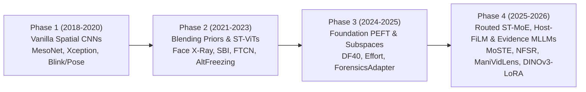

# Detection and Localization of AI-Manipulated Videos: Literature Survey, Technology-Mitigation Matrix & Research Scope (2018–2026)

> [!IMPORTANT]
> **Scope Boundary — AI-Manipulated vs. AI-Generated Videos:** This work targets **AI-manipulated authentic videos** (camera-captured host streams where localized identities, facial expressions, lip kinematics, objects, attributes, or sparse temporal/audio-visual intervals are altered) and **explicitly excludes** fully synthesized Text-to-Video (T2V) or unconstrained Image-to-Video (I2V) clips generated from scratch. Recent benchmarks (*ManiVid*, *AV-FABLE*) demonstrate that whole-video synthesis detectors drop to **50.1%–56.2% accuracy (near chance)** on localized manipulations because 70%–95% of pixels and motion trajectories remain genuinely camera-captured.

---

## 1. Evolution of Video Manipulation Forensics (2018–2026)

Systematic analysis of peer-reviewed literature across CVPR, ICCV, ECCV, NeurIPS, ICML, ICLR, ACM MM, and IEEE TIFS reveals four distinct architectural eras:

### 1.1 Four Detection Paradigms

1. **Phase 1 — Spatial CNNs & Heuristic Biometrics (2018–2020):** Frame-level classifiers (*MesoNet*, *XceptionNet*, *Capsule-Forensics*) and early physiological heuristics (*In Ictu Oculi* eye blinking, head-pose PnP discrepancies). Achieved >98% in-domain AUROC on uncompressed *FaceForensics++ (FF++)*, but degraded sharply under H.264 compression (`c23`/`c40`) and unseen generators.
2. **Phase 2 — Pseudo-Fake Blending Augmentation & Spatio-Temporal Consistency (2021–2023):**
   - **Self-Supervised Blending Priors:** *Face X-Ray* (CVPR'20) and **Self-Blended Images (SBI)** (CVPR'22) trained detectors purely on real frames blended with distorted copies of themselves, forcing models to learn universal warping, color-mismatch, and boundary cues rather than generator-specific fingerprints. Extended to frequency blending (*FreqBlender*, NeurIPS'24; *FSBI*, 2025) and video landmark drift (*ProDet*, NeurIPS'24).
   - **Spatio-Temporal & Motion Backbones:** *LipForensics* (CVPR'21) targeted mouth-motion anomalies pretrained on lipreading; *FTCN* (ICCV'21) zeroed spatial convolution kernels to enforce temporal coherence learning; **AltFreezing** (CVPR'23) alternately froze spatial and temporal weights in 3D ResNets; *TALL* (ICCV'23) rearranged video frames into spatial thumbnail grids; *StyleLatentFlow* (CVPR'24) tracked temporal discontinuities in StyleGAN latent trajectories.
   - **Disentanglement:** *UCF* (ICCV'23) and *LSDA* (CVPR'24) separated content/identity features from forgery features and augmented forgery latent spaces.
3. **Phase 3 — Vision Foundation Model Adaptation & Orthogonal Subspaces (2024–2025):**
   - Large pretrained encoders (**CLIP ViT-L/14**, **DINOv2**, **SigLIP**) replaced CNNs trained from scratch (*Ojha et al.*, CVPR'23).
   - **Effort** (*Yan et al.*, ICML 2025): Decomposed pretrained ViT weight matrices via SVD, freezing the principal singular components (preserving generalizable semantic knowledge) while learning residual orthogonal low-rank matrices to capture forgery traces without overfitting.
   - **ForensicsAdapter (ForAda)** (*Cui et al.*, CVPR 2025): Injected lightweight blending-aware spatial interaction adapters into frozen CLIP ViT blocks.
   - **DFD-FCG** (*Han et al.*, CVPR 2025) & **FSFM** (CVPR 2025): Component-guided spatio-temporal side-decoders and self-supervised facial security representations.
4. **Phase 4 — Conditional Spatio-Temporal MoE, Host-Conditioned Readouts & Evidence-Routed Grounding (2025–2026):**
   - **Resolving Manipulation-Family Conflict (*MoSTE*, 2026):** Demonstrated that single-pathway PEFT (*Effort*, *ForensicsAdapter*) tuned on **Face Swap** (spatial/blending dominant) drops by 17–20% AUROC on **Face Reenactment** (66.7%–68.8% AUC on *DF40* reenactment), whereas temporal adapters degrade on challenging swaps (*DFDC*). *MoSTE* inserts parallel **Spatial and Temporal Expert Pools** inside frozen CLIP-ViT-L/14 with **auxiliary-loss-free token-level Top-$k$ routing** (bias-update load balancing), reaching **92.4% average cross-dataset AUC**.
   - **Degradation-Hardened DINOv3 Backbones (*NTIRE 2026 Deepfake Detection Challenge*, CVPRW'26):** Under blind compound social-media and anti-forensic degradations, **DINOv3-Large** with parameter-efficient adaptation and compound degradation training outperformed legacy CNNs and vanilla CLIP.
   - **The MLLM / AV-LLM Perception-vs-Language Gap (*AV-FABLE / NFSR*, 2026):** Showed that zero-shot text-prompted multimodal LLMs (*Qwen2.5-Omni*, *Qwen3-Omni*) perform near random chance (**50%–52% AUROC**) on sparse audio-visual video manipulations, whereas native temporal probes on frozen intermediate perceptual features achieve **>90% AUROC** when paired with **Host-Conditioned FiLM** and **Modality-Separated Temporal Decoders**.
   - **Unified Pixel-Level Video Grounding (*ManiVid / ManiVidLens*, 2026):** Paired a low-level forensic encoder (*AIDE*) with a 7B VLM and *SAM2* to output binary detection (`0.914 F1`) and dense video masks (`0.407 mIoU` overall), but suffered **`~16 s/clip` latency** and collapsed to **`0.135 mIoU` on Object Removal**.

---

### 1.2 Critical Methodological Critiques in Modern Evaluation

> [!WARNING]
> **Three Evaluation Pitfalls in Video Forensics:**
> 1. **Per-Dataset AUC & Score Polarization (*When AUC Misleads*, 2026; *MID-FFD*, CVPR 2026):** Evaluating AUROC separately on each target dataset conceals **domain polarization**—where a detector assigns `[0.01, 0.10]` to real/fake on Dataset A and `[0.75, 0.95]` to real/fake on Dataset B. Both yield `0.95 AUROC` individually, yet fail under a single deployment threshold (`FAR > 25%`). Rigorous evaluation requires fixed-threshold validation calibration (`Realized FAR`, `MID-FFD Accuracy`) and **Cross-AUC** (penalizing Wasserstein-1 score drift).
> 2. **Codec & Container Shortcut Leakage (*AV-FABLE*, 2026):** In legacy datasets (*FakeAVCeleb*, *LAV-DF*), fake clips often underwent an extra `ffmpeg` re-encode or audio resampling step relative to real clips, allowing codec-only probes to achieve artificially high AUROC. Training and evaluation pipelines must enforce symmetric transcoding/degradation across real and manipulated clips.
> 3. **Physiological Shortcut Illusion & Identity Leakage:** Remote photoplethysmography (rPPG) detectors primarily latch onto high-frequency generator flicker and compression provenance rather than cardiac pulse, requiring strict identity-disjoint and codec-matched protocols.

---

### 1.3 Key Benchmarks & Open-Source Codebases

| Resource / Benchmark | Year / Venue | Scale & Resolution | Manipulation Scope | Tasks Supported | Availability |
| :--- | :--- | :--- | :--- | :--- | :--- |
| **DeepfakeBench** (`SCLBD/DeepfakeBench`) | NeurIPS'23 | Unified codebase (36+ detectors) | Facial Swap, Reenactment, Synthesis | Standardized Train/Eval | Open Source |
| **DF40** (`SCLBD/DF40`) | NeurIPS'24 | >1M clips/frames, **40 methods** | Face Swap, Face Reenactment, Editing, Synth | Cross-Manipulation Gen. | Open Source |
| **IMDL-BenCo** (`scu-zjz/IMDLBenCo`) | NeurIPS'24 | Modular localization codebase | Splicing, Inpainting, Diffusion Edits | Pixel Mask Localization | Open Source |
| **Celeb-DF / CDF-v3** | CVPR'20 / '25 | 590 real / 53K+ fake videos | Face Swap, Reenactment, Talking Head | Cross-Dataset Video Gen. | Academic Release |
| **AV-Deepfake1M++** (`ControlNet/AV-Deepfake1M`) | ACM MM'24 / '25 | **2.05M videos** (628K real / 1.42M fake) | LLM-driven partial Audio-Visual speech/lip edits | Detection + Temporal Loc. | Open Source |
| **TalkingHeadBench** | 2025–2026 | 5,296 curated videos | *LivePortrait*, *EMO*, *LatentSync*, *MuseTalk* | Multimodal OOD Detection | Public Benchmark |
| **TASLE & ActivityForensics** | CVPR'26 | 12.5K / 5.4K untrimmed open-scene videos | Sparse visual event/action diffusion edits | Temporal Forgery Loc. | Public Benchmarks |
| **ManiVid-38K & ManiVidBench** | 2026 | 38K videos (19K 1080p pairs), 15 editors | Open-vocab V2V/I2V: Add, Remove, Replace, Portrait | Det + Mask Grounding | Public Benchmark |
| **AV-FABLE** | 2026 | 33,300 long videos (998h), **pristine twins** | 27 A/V editing configs (median 9.45% edited) | Native-Track A/V Temp. Loc. | Public Manifests |

---

## 2. Taxonomy of AI Video Manipulation Technologies & Mitigations

Below is the systematic mapping of all **8 active AI video manipulation families** (excluding 100% synthetic T2V generation), their manipulation mechanisms, forensic vulnerabilities, state-of-the-art mitigations, and remaining blind spots addressed by **HoST-MoE**.

### 2.1 Summary Technology-vs-Mitigation Matrix

| # | Manipulation Family | Representative Models / Tools | Primary Mechanism | Key Forensic Vulnerabilities | Existing SOTA Mitigation | Remaining Blind Spot Addressed by HoST-MoE |
| :- | :--- | :--- | :--- | :--- | :--- | :--- |
| **1** | **AE & GAN Face Swapping** | *FaceFusion 3.x*, *InSwapper*, *SimSwap*, *BlendFace*, *E4S* | ArcFace ID injection + cropped GAN/AE decode + mask feathering | Affine warp grid, inner/outer noise & sharpness step, ID-vs-skull mismatch | *SBI*, *ForensicsAdapter*, *Effort*, *MoSTE* spatial pool | Full-frame *CodeFormer* / *GFPGAN* laundering erases pixel seam |
| **2** | **Diffusion / DiT & Flow Face Swap** | *DreamID-V*, *StreamingSwap*, *LivingSwap*, *CanonSwap*, *DiffSwap* | 3D Causal VAE + DiT / Flow-Matching conditioned on target video + ref ID | RoI latent double-encoding, specular corneal mismatch, rollout window resets | DINOv3 patch probes, specular consistency, orthogonal subspaces | Seamless diffusion harmonization defeats *SBI* & *Face X-Ray* |
| **3** | **Portrait Animation & Reenactment** | *LivePortrait*, *Hallo3*, *Sonic*, *OmniHuman-1*, *MimicMotion* | Implicit 3D keypoints / motion latents warp or diffuse source portrait | Action-Unit (AU) co-occurrence errors, static hair/collar shear | *MoSTE* temporal pool, *StyleLatentFlow*, AU-guided ViTs | Single-pathway CLIP adapters (*Effort*, *ForAda*) drop ~18% AUC |
| **4** | **AI Lip-Syncing & Visual Dubbing** | *LatentSync*, *MuseTalk*, *Wav2Lip*, *VideoReTalking*, *StyleSync* | Masked lower-face/mouth latent diffusion or GAN driven by audio | Upper-head/cheek vs. jaw velocity decoupling, intra-oral teeth flicker | Upper-vs-lower facial kinematics, articulatory VSR consistency | Mouth-only *SyncNet* detectors fail on *LatentSync* (SyncNet-trained) |
| **5** | **Video Inpainting & Object Removal** | *ProPainter*, *VideoPainter*, *DiffuErasor*, *FFF-VDI* | SAM2 mask + optical-flow completion + temporal transformer/diffusion fill | Flow interpolation smoothing, suppressed camera PRNU/ISP micro-texture | Constrained zero-DC filters, Noiseprint, optical-flow residuals | Semantic MLLM localizers (*ManiVidLens*) collapse to **`0.135 mIoU`** |
| **6** | **Instruction-Guided Video Editing** | *VACE*, *Kling Omni*, *Runway Aleph*, *OmniInsert* | Masked V2V DiT or Frame-1 edit (*FLUX*, *Qwen-Image-Edit*) + Canny/Depth I2V | Cast-shadow errors, SAM2 halo seams, local vs. host VAE spectral step | *ManiVidLens* (`AIDE` + MLLM + `SAM2`), DINOv3 token trajectories | Multi-second MLLM latency (`~16 s/clip`) prevents scalable screening |
| **7** | **Sparse Long-Form Audio-Visual Edits** | *CosyVoice 2* / *F5-TTS* + *LatentSync* / *VACE* spliced into host video | Event-level 2–10s A/V edit reinserted into minute-scale authentic video | Room-impulse-response (RIR) step, host-relative visual shift at `[t_s, t_e]` | *AV-FABLE NFSR* (Host FiLM + Modality-Separated Pyramids) | Early A/V fusion bleeds visual anomalies onto clean audio (`12–15%` FAR) |
| **8** | **Anti-Forensic Laundering & Transcoding** | *CodeFormer*, *GFPGAN*, *Real-ESRGAN*, VAE round-trip, H.265/AV1 CRF 35+ | Washes out high-freq spectra & shifts global feature channel statistics | Persistent intra-video differential outliers & biomechanical mismatches | Compound degradation training, symmetric laundering, Host SHDC | Uncalibrated detectors suffer severe cross-domain score polarization |

---

### 2.2 Technical Breakdown by Manipulation Family

#### Family 1: Classical Autoencoder & GAN Face Swapping
- **Mechanism:** Aligns the target face into a canonical crop (`128x128` to `512x512`), injects a source *ArcFace* identity embedding via AdaIN or cross-attention (*SimSwap*, *InSwapper*, *FaceFusion*), decodes the swapped inner face, warps it back via inverse affine transformation, and blends it using feathered face-parsing masks.
- **Forensic Mitigation:** Inverse affine warping creates resampling/aliasing discontinuities between the inner face and outer skin/neck (*BayarConv2d* + *Pool S*), while inner-face identity features diverge from cranial/ear/neck geometry.

#### Family 2: Diffusion, DiT & Flow-Matching Video Face Swapping
- **Mechanism:** Formulates face swapping as reference-guided conditional video latent flow-matching on 3D Causal VAEs and Diffusion Transformers (*DreamID-V*, *StreamingSwap*, *DiffSwap*). Iterative latent denoising harmonizes skin pores and boundaries, defeating legacy pixel-blending detectors (*SBI*).
- **Forensic Mitigation:** RoI-based streaming swappers leave a **3D-VAE double-encoding boundary** between the edited face box and untouched background host tokens (captured by `SHDC` + `MN-Stem`), while short-window temporal rollouts introduce periodic micro-phase resets (captured by `Pool T` with 1D RoPE).

#### Family 3: Portrait Animation & Facial Reenactment
- **Mechanism:** Transfers facial expressions and head motion onto a source identity via implicit 3D keypoints + stitching (*LivePortrait*) or audio/pose-conditioned DiTs (*Hallo3*, *Sonic*). Because skin texture originates from a genuine photograph, spatial-only adapters misclassify reenacted frames as real.
- **Forensic Mitigation:** Dedicated **Axial-RoPE Temporal Experts (`Pool T`)** track patch trajectories across $T$ frames without interfering with spatial seam experts (`Pool S`), capturing non-rigid warping elasticity, Action-Unit co-activation violations, and quasi-static hair/collar shear.

#### Family 4: AI Lip-Syncing & Visual Dubbing
- **Mechanism:** Inpaints only the lower mouth/jaw region conditioned on driving speech (*Wav2Lip*, *MuseTalk*, *LatentSync*). Because *LatentSync* optimizes directly against a *SyncNet* discriminator during generation, mouth-crop audio-visual correlation detectors are systematically fooled.
- **Forensic Mitigation:** Natural prosodic pitch accents engage upper-head nods, eyebrow micro-lifts, and cheek compression. **HoST-MoE**'s directional **Kinematic-Prosodic Verifier (`KP-Verify`)** cross-attends host-anchored upper-head motion velocity against `SHDC`-conditioned *WavLM* prosody tokens, while substituting a learned **Silent-Prior ($\mathbf{e}_\emptyset$)** when audio is absent.

#### Family 5: Localized Video Inpainting & Object Erasure
- **Mechanism:** Given an object mask, flow-guided inpainters (*ProPainter*, *VideoPainter*, *DiffuErasor*) propagate background pixels along completed optical-flow fields and synthesize disoccluded regions via temporal transformers or latent diffusion.
- **Forensic Mitigation:** Semantic encoders see plausible empty background (grass, wall, road) and fail (`0.135 mIoU`). **HoST-MoE**'s **Motion-Noise Forensic Residual Stem (`MN-Stem`)** combines zero-DC constrained Bayar convolutions + 9 SRM high-pass filters (exposing suppressed camera PRNU/ISP micro-texture) with a `<2 ms` `1/4`-resolution local correlation cost-volume motion residual (exposing over-smoothed optical flow), routed directly into **Forensic-Residual Experts (`Pool R`)** and skipped into the **Tubelet Mask Decoder**.

#### Family 6: Open-Vocabulary Instruction-Guided Video Editing
- **Mechanism:** Either masks and edits regions directly via V2V DiTs (*VACE*, *Kling Omni*) or edits Frame 1 and regenerates the clip under Canny/Depth control.
- **Forensic Mitigation:** Multi-depth `DINOv3-ViT-L/16` intermediate tokens ($\ell \in \{6, 12, 18, 24\}$) paired with `SHDC` contrast edited tubelets against unedited scene context in **`~28 ms/clip`** (`~570x` faster than 7B MLLM + SAM2 pipelines).

#### Family 7: Sparse Long-Form Multi-Modal Event Splicing
- **Mechanism:** Alters 2–10 seconds of cloned speech (*CosyVoice 2*, *F5-TTS*) and/or visual lip/scene content inside a longer authentic recording (*AV-Deepfake1M++*, *AV-FABLE*).
- **Forensic Mitigation:** Independent **Visual ($\mathcal{D}_v$)** and **Audio ($\mathcal{D}_a$)** multi-scale temporal pyramid decoders conditioned on modality-specific `SHDC` host baselines localize `[t_start, t_end]` intervals on each native track without cross-modality false-alarm bleed.

#### Family 8: Anti-Forensic Laundering & Codec Transcoding
- **Mechanism:** Passing manipulated clips through full-frame neural restoration (*CodeFormer*, *GFPGAN*), VAE round-trips, or heavy H.265/AV1 social-media transcoding shifts global feature distributions and erases fragile spectral artifacts.
- **Forensic Mitigation:** (1) **Symmetric Laundering Training** applies simulated restoration/VAE laundering ($p = 0.15$) equally to pristine real and manipulated training clips so enhancement never becomes a false-positive shortcut; and (2) **Median-Gated `SHDC` + `PristineQuantileCalibrator`** cancels arbitrary per-channel affine codec/restoration shifts while bounding false-alarm rates on authentic videos.

---

## 3. Unifying Thesis: Host-Differential Video Forensics

Every localized manipulation of a camera-captured video embeds an anomalous foreground inside an unmanipulated host stream. Rather than evaluating patches against static training-set decision boundaries that drift across cameras and codecs, **HoST-MoE** dynamically estimates an uncontaminated **Host Prototype $(\boldsymbol{\mu}_{\text{host}}, \boldsymbol{\sigma}_{\text{host}})$** inside each clip and measures forensic anomalies differentially against that video's own sensor, compression, and restoration baseline:

- **Mathematical Architecture & Proofs:** See [`docs/mathematical_and_architectural_spec.md`](mathematical_and_architectural_spec.md)
- **Controlled Empirical Mechanism Verification:** See [`docs/empirical_verification_results.md`](empirical_verification_results.md)
- **Compiled 7-Page Research Manuscript:** See [`paper/main.pdf`](../paper/main.pdf) ([`paper/main.tex`](../paper/main.tex))
