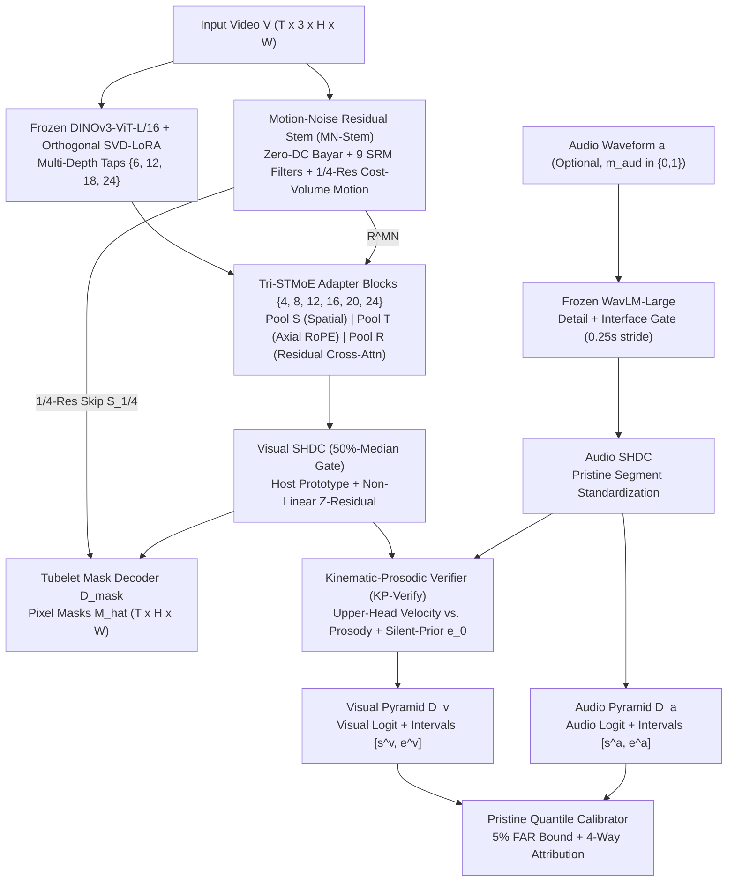

# HoST-MoE: Complete Mathematical & Architectural Specification

**Manuscript Title:** *HoST-MoE: Host-Differential Spatio-Temporal Mixture of Experts for Unified Detection and Localization of AI-Manipulated Videos* ([`paper/main.pdf`](../paper/main.pdf))

---

## 1. Problem Formulation

Given an input video clip $\mathbf{V} \in \mathbb{R}^{T \times 3 \times H \times W}$ spanning duration $T_{\text{sec}}$ seconds and an optional mono audio waveform $\mathbf{a} \in \mathbb{R}^{L_a}$ accompanied by availability indicator $m_{\text{aud}} \in \{0, 1\}$ ($m_{\text{aud}} = 0$ for silent videos), **HoST-MoE** (`src/host_forensics/models/host_model.py`) outputs four calibrated predictions in a single forward pass:

1. **Calibrated Video Manipulation Probability:** $\hat{p} \in [0, 1]$ calibrated against an authentic validation quantile budget ($\text{FAR} \le \delta$, default $\delta = 0.05$).
2. **Four-Way Modality Attribution:** $\hat{c} \in \{\texttt{clean}, \texttt{visual}, \texttt{audio}, \texttt{both}\}$ (automatically reducing to $\{\texttt{clean}, \texttt{visual}\}$ when $m_{\text{aud}} = 0$).
3. **Modality-Separated Temporal Intervals:** Visual proposals $\widehat{\mathcal{I}}_v = \{(\hat{s}_m^v, \hat{e}_m^v, \hat{c}_m^v)\}$ and (when $m_{\text{aud}} = 1$) audio proposals $\widehat{\mathcal{I}}_a = \{(\hat{s}_n^a, \hat{e}_n^a, \hat{c}_n^a)\}$ merged via 1D Temporal Soft-NMS.
4. **Dense Spatio-Temporal Forgery Mask:** $\widehat{\mathbf{M}} \in [0, 1]^{T \times H \times W}$ localizing manipulated faces, edited objects/materials, or flow-inpainted object-removal regions.

---

## 2. Subsystem Equations & Proofs

### 2.1 Motion-Noise Forensic Residual Stem (`MN-Stem`)
Implemented in [`src/host_forensics/models/mn_stem.py`](../src/host_forensics/models/mn_stem.py).

1. **Dynamically Constrained Zero-DC Noiseprint Branch (`BayarConv2d` + `SRMFilterBank`):**
   Each frame $\mathbf{I}_t \in \mathbb{R}^{3 \times H \times W}$ passes through $C_b = 12$ learnable $5 \times 5$ Bayar convolutions and 9 fixed Spatial Rich Model (SRM) high-pass kernels. On every forward pass, off-center weights are softmax-normalized with temperature while the center tap is pinned to $-1$:
   $$\mathbf{K}_{o,i}(0, 0) = -1, \qquad \sum_{(u,v) \neq (0,0)} \mathbf{K}_{o,i}(u, v) = +1$$
   Consequently $\sum_{u,v} \mathbf{K}_{o,i}(u, v) = 0$ holds identically before and after every optimizer step, suppressing low-frequency scene luminance/color and isolating camera ISP/PRNU suppression and resampling traces.

2. **Fast `1/4`-Resolution Local Cost-Volume Motion Residual (`LocalCostVolumeMotionResidual`):**
   Frames are projected into $\ell_2$-normalized shallow spatial features $\tilde{\mathbf{F}}_t \in \mathbb{R}^{C_s \times (H/4) \times (W/4)}$. Within a local $(2r+1) \times (2r+1)$ window $\mathcal{N}_r$ ($r = 2$, 25 displacements), bidirectional correlation attention is computed against adjacent frames $\tilde{\mathbf{F}}_{t \pm 1}$:
   $$\mathbf{A}_{t \to t\pm 1}(\mathbf{x}, \boldsymbol{\delta}) = \operatorname{softmax}_{\boldsymbol{\delta} \in \mathcal{N}_r}\!\left(\frac{\langle \tilde{\mathbf{F}}_t(\mathbf{x}), \tilde{\mathbf{F}}_{t\pm 1}(\mathbf{x} + \boldsymbol{\delta}) \rangle}{\tau_c}\right)$$
   Concatenating forward/backward motion-compensated reconstruction error $\|\tilde{\mathbf{F}}_t - \hat{\mathbf{F}}_{t \leftarrow t\pm 1}\|_2$ and normalized correlation entropy $-\frac{1}{\log |\mathcal{N}_r|} \sum_{\boldsymbol{\delta}} \mathbf{A} \log \mathbf{A}$ exposes flow-propagated object-removal smoothing (*ProPainter*, *VideoPainter*) in `< 2 ms` without external optical-flow networks. Strided $4 \times 4$ projection aligns $\mathbf{R}^{\text{MN}} \in \mathbb{R}^{T \times P \times d_r}$ to the $P = \frac{H}{16}\frac{W}{16}$ ViT patches while exporting $\mathbf{S}_{1/4}$ as a high-resolution skip tensor.

---

### 2.2 Principal-Subspace-Orthogonal SVD-LoRA & Auxiliary-Loss-Free `Tri-STMoE`
Implemented in [`src/host_forensics/models/backbones.py`](../src/host_forensics/models/backbones.py) and [`src/host_forensics/models/tri_stmoe.py`](../src/host_forensics/models/tri_stmoe.py).

1. **Orthogonal SVD-LoRA (`OrthogonalSVDLinear`):**
   Given a frozen pretrained linear projection $\mathbf{W}_0 = \mathbf{U}\boldsymbol{\Sigma}\mathbf{V}^\top \in \mathbb{R}^{d_{\text{out}} \times d_{\text{in}}}$ in `DINOv3-ViT-L/16`, let $\mathbf{U}_k \in \mathbb{R}^{d_{\text{out}} \times k_p}$ and $\mathbf{V}_k \in \mathbb{R}^{d_{\text{in}} \times k_p}$ contain its top-$k_p$ singular vectors ($k_p = 64$). Trainable rank-$r$ ($r = 16$) adapters $\mathbf{B}, \mathbf{A}$ are projected onto the orthogonal complement of the pretrained semantic subspace:
   $$\Delta \mathbf{W}_{\perp} = (\mathbf{I} - \mathbf{U}_k \mathbf{U}_k^\top)\mathbf{B}\mathbf{A}(\mathbf{I} - \mathbf{V}_k \mathbf{V}_k^\top), \qquad \mathbf{W} = \mathbf{W}_0 + \Delta \mathbf{W}_{\perp}$$
   By projector idempotency, $\mathbf{U}_k^\top \Delta \mathbf{W}_{\perp} = \mathbf{0}$ and $\Delta \mathbf{W}_{\perp} \mathbf{V}_k = \mathbf{0}$ hold identically throughout training.

2. **Tri-Pool Forensic MoE (`TriSTMoEAdapter`):**
   At adapted ViT blocks $\ell \in \{4, 8, 12, 16, 20, 24\}$, bottleneck tokens $\mathbf{X}_{\text{mid}}^{(\ell)} \in \mathbb{R}^{T \times P \times d_m}$ ($d_m = 128$) route concurrently through three decoupled pools ($E = 4$ experts, top-$k = 2$ per pool):
   - **Pool $\mathcal{S}$ (`SpatialAttentionExpert`):** Intra-frame patch self-attention targeting blending seams, 3D geometry, and lighting mismatches.
   - **Pool $\mathcal{T}$ (`TemporalAttentionExpert`):** Axial temporal self-attention across $T$ frames per spatial patch $i$ with 1D Rotary Position Embeddings (`Rotary1D`), capturing reenactment jitter and diffusion rollout resets.
   - **Pool $\mathcal{R}$ (`ResidualCrossAttentionExpert`):** Cross-attention querying $\mathbf{X}_{\text{mid}}^{(\ell)}$ against keys/values $\mathbf{X}_{\text{mid}}^{(\ell)} + \mathbf{W}_r \mathbf{R}^{\text{MN}}$, coupling semantic boundaries to camera noiseprint and flow-inpainting residuals.

3. **Auxiliary-Loss-Free Bias Balancing (`BiasBalancedTopKRouter`):**
   Each pool $p \in \{\mathcal{S}, \mathcal{T}, \mathcal{R}\}$ maintains a non-differentiable routing bias $\mathbf{b}_p \in \mathbb{R}^E$. Top-$k$ indices $\mathcal{I}_p$ are selected via $\mathbf{g}_p(\mathbf{u}) + \mathbf{b}_p$, whereas combination weights use unbiased $\operatorname{softmax}(\mathbf{g}_p(\mathbf{u})|_{\mathcal{I}_p})$. After each optimizer step, biases update purely from empirical token load $f_{p,e}$ without adding auxiliary gradient noise:
   $$b_{p,e} \leftarrow b_{p,e} + \gamma \operatorname{sign}\!\left(\frac{1}{E} - f_{p,e}\right)$$

---

### 2.3 Self-Referential Host-Prototype Differential Conditioning (`SHDC`)
Implemented in [`src/host_forensics/models/shdc.py`](../src/host_forensics/models/shdc.py).

Let $\mathbf{Z} \in \mathbb{R}^{M \times D}$ ($M = T P$ for visual tokens or $M = T_a$ for audio tokens) denote fused tokens for a single clip.

1. **50%-Breakdown-Point Coordinate-Wise Median Gating:**
   To prevent outlier contamination whenever $< 50\%$ of tokens are manipulated, we standardize $\mathbf{Z}$ across the token index $m \in \{1, \dots, M\}$ per channel $d$ using the coordinate-wise median $\operatorname{med}_m(Z_{m,d})$ and standard deviation $s_d = \operatorname{std}_m(Z_{m,d})$ before scoring pristine likelihood $\alpha_m \in (0, 1)$ via the Authenticity Anchor Gate $g_\phi$:
   $$\hat{Z}_{m,d}^{\text{med}} = \frac{Z_{m,d} - \operatorname{med}_{m'}(Z_{m',d})}{s_d + \varepsilon}, \qquad \alpha_m = \sigma\!\left(g_\phi(\hat{\mathbf{Z}}_m^{\text{med}})\right), \qquad \tilde{\alpha}_m = \frac{\alpha_m^\beta}{\sum_{m'=1}^M \alpha_{m'}^\beta + \varepsilon}$$
   with sharpening exponent $\beta = 2$.

2. **Uncontaminated Host Prototype & Amplitude-Preserving Non-Linear Z-Residual:**
   Using sharpened host weights $\tilde{\alpha}_m$, we estimate intra-video Host Prototype moments and standardized Z-residuals:
   $$\mu_{\text{host}, d} = \sum_{m=1}^M \tilde{\alpha}_m Z_{m,d}, \qquad \sigma_{\text{host}, d} = \sqrt{\sum_{m=1}^M \tilde{\alpha}_m (Z_{m,d} - \mu_{\text{host}, d})^2 + \varepsilon}$$
   $$\tilde{Z}_{m,d}^{\text{std}} = \frac{Z_{m,d} - \mu_{\text{host}, d}}{\sigma_{\text{host}, d}}, \qquad \mathbf{H}_m^{\text{diff}} = 10 \tanh\!\left(\frac{\boldsymbol{\omega} \odot \big(\tilde{\mathbf{Z}}_m^{\text{std}} + \psi_{\text{MLP}}(\tilde{\mathbf{Z}}_m^{\text{std}})\big)}{10}\right)$$
   where $\psi_{\text{MLP}}$ is a two-layer `GELU` MLP and $\boldsymbol{\omega} \in \mathbb{R}^D$ is a learnable channel gain. Crucially, unlike per-token `LayerNorm` (which divides each token by its own norm and erases Mahalanobis outlier amplitude) or purely linear mean centering (which creates a zero-sum saddle point $\sum_m (\mathbf{Z}_m - \bar{\mathbf{Z}}) \equiv \mathbf{0}$ under uniform initial pooling), $\mathbf{H}_m^{\text{diff}}$ preserves exact Z-score anomaly magnitude while breaking zero-sum cancellation via $\psi_{\text{MLP}}$.

> [!NOTE]
> **Proposition 1 (Strict Per-Channel Positive Affine-Shift Invariance).**
> *Let $\mathbf{Z}' \in \mathbb{R}^{M \times D}$ be generated from $\mathbf{Z}$ via an arbitrary per-channel positive scale and shift $Z'_{m,d} = a_d Z_{m,d} + c_d$ with $a_d > 0$ and $c_d \in \mathbb{R}$ for all $d \in \{1, \dots, D\}$. Up to numerical $\varepsilon$, the anchor probabilities $\boldsymbol{\alpha}$, standardized Z-residuals $\tilde{\mathbf{Z}}^{\text{std}}$, and differential output $\mathbf{H}^{\text{diff}}$ satisfy $\boldsymbol{\alpha}(\mathbf{Z}') = \boldsymbol{\alpha}(\mathbf{Z})$ and $\mathbf{H}^{\text{diff}}(\mathbf{Z}') = \mathbf{H}^{\text{diff}}(\mathbf{Z})$.*
>
> *Proof.* Because $x \mapsto a_d x + c_d$ is strictly increasing for $a_d > 0$, order statistics commute with the transform: $\operatorname{med}_m(Z'_{m,d}) = a_d \operatorname{med}_m(Z_{m,d}) + c_d$, while $\operatorname{std}_m(Z'_{m,d}) = a_d s_d$. Thus $\hat{\mathbf{Z}}'^{\text{med}} = \hat{\mathbf{Z}}^{\text{med}}$ and $\tilde{\alpha}'_m = \tilde{\alpha}_m$. Since $\sum_m \tilde{\alpha}_m = 1$, $\mu'_{\text{host}, d} = a_d \mu_{\text{host}, d} + c_d$ and $\sigma'_{\text{host}, d} = a_d \sigma_{\text{host}, d}$. Therefore $\tilde{Z}'^{\text{std}}_{m,d} = \frac{a_d(Z_{m,d} - \mu_{\text{host}, d})}{a_d \sigma_{\text{host}, d}} = \tilde{Z}^{\text{std}}_{m,d}$, whence $\mathbf{H}^{\text{diff}}(\mathbf{Z}') = \mathbf{H}^{\text{diff}}(\mathbf{Z})$. $\square$

---

### 2.4 Modality-Decoupled Readouts (`MDNR`), `KP-Verify` & Pristine Calibration
Implemented in [`src/host_forensics/models/heads.py`](../src/host_forensics/models/heads.py) and [`src/host_forensics/models/host_model.py`](../src/host_forensics/models/host_model.py).

- **Directional Kinematic-Prosodic Verifier (`KinematicProsodicVerifier`):** Pools host-anchored upper-head temporal velocity $\Delta_t \mathbf{h}_t^{\text{pose}}$ and cross-attends into `SHDC`-conditioned *WavLM* audio tokens $\mathbf{A}^{\text{SHDC}}$. When $m_{\text{aud}} = 0$ or under training-time modality dropout ($p_{\text{drop}} = 0.35$), `KP-Verify` substitutes a learned **Silent-Prior token $\mathbf{e}_\emptyset \in \mathbb{R}^{d_h}$**, guaranteeing seamless visual-only inference without separate checkpoints.
- **Modality-Separated Pyramids (`MultiScaleTemporalPyramidDecoder`):** The audio pyramid $\mathcal{D}_a$ operates *exclusively* on $\mathbf{A}^{\text{SHDC}}$ (preventing visual-to-audio false-alarm bleed), while $\mathcal{D}_v$ operates on anomaly-pooled visual tokens concatenated with `KP-Verify` context across 4 dilated 1D-conv scales with Focal + 1D-DIoU regression and Soft-NMS.
- **Spatial Tubelet Mask Head (`SpatialTubeletMaskDecoder`):** Fuses $\mathbf{Z}^{\text{SHDC}}$, shallow ViT skip tokens, and `MN-Stem`'s $\mathbf{S}_{1/4}$ via 3D depthwise spatio-temporal convolutions to predict dense masks $\widehat{\mathbf{M}} \in [0, 1]^{T \times H \times W}$.
- **Pristine Quantile Calibrator (`PristineQuantileCalibrator`):** Fixes visual and audio logit thresholds $(q_v^*, q_a^*)$ once at empirical $(1 - \delta)$ quantiles on authentic source-validation clips ($\delta = 0.05$), producing bounded-FAR calibrated probabilities and 4-way attribution without test-set threshold tuning.

---

## 3. Heterogeneous Multi-Task Objective & Single-GPU Footprint

### 3.1 Task-Masked Objective (`HeterogeneousForensicLoss`)
Implemented in [`src/host_forensics/losses/forensic_losses.py`](../src/host_forensics/losses/forensic_losses.py) to support mixed batches with partial supervision (video-only labels, temporal intervals, or dense pixel masks):

$$\mathcal{L} = \mathcal{L}_{\text{cls}} + \lambda_{\text{pol}} \operatorname{Var}_{y=0}\!\left(\ell^{\text{vid}}\right) + \lambda_{\text{anc}} \mathcal{L}_{\text{anc}} + m_{\text{tfl}} \mathcal{L}_{\text{TFL}} + m_{\text{mask}} \mathcal{L}_{\text{mask}}$$

- $\operatorname{Var}_{y=0}(\ell^{\text{vid}})$ penalizes raw logit dispersion across authentic clips from distinct domains/degradations.
- $\mathcal{L}_{\text{anc}}$ applies inverse-mask BCE when $m_{\text{mask}} = 1$ and a multiple-instance top-$k$ host vs. bottom-$k$ RoI margin loss when $m_{\text{mask}} = 0$.
- $\mathcal{L}_{\text{TFL}} = \mathcal{L}_{\text{Focal}} + \lambda_{\text{diou}} \mathcal{L}_{\text{1D-DIoU}}$, and $\mathcal{L}_{\text{mask}} = \mathcal{L}_{\text{BCE}} + \mathcal{L}_{\text{Dice}} + \lambda_{\text{lap}} \mathcal{L}_{\text{Laplacian}}$.

### 3.2 Parameter & RTX 5090 (32 GB, BF16) Memory Budget

| Subsystem | Total Params | Trainable Params | BF16 VRAM (`T=16, 384x384, B=4`) |
| :--- | ---: | ---: | ---: |
| Frozen `DINOv3-ViT-L/16` + `WavLM-Large` | `463.1M` | `0.0M` | `2.1 GB` |
| Orthogonal SVD-LoRA ($r=16, k_p=64$) | `3.1M` | `3.1M` | `1.4 GB` |
| `MN-Stem` (Bayar + SRM + Cost-Volume) | `1.4M` | `1.4M` | `2.6 GB` |
| `Tri-STMoE` (6 blocks $\times$ 3 pools) | `11.8M` | `11.8M` | `6.9 GB` |
| `SHDC` + `KP-Verify` + Silent-Prior | `3.4M` | `3.4M` | `2.2 GB` |
| `MDNR` Pyramids ($\mathcal{D}_v, \mathcal{D}_a$) + $\mathcal{D}_{\text{mask}}$ | `5.2M` | `5.2M` | `3.0 GB` |
| **Total HoST-MoE** | **`488.0M`** | **`24.9M (5.1%)`** | **`18.2 GB / 32.0 GB`** |

---

## 4. Two-Stage Curriculum & Controlled Ablations (`scripts/run_rtx5090_suite.sh`)

1. **Stage 1 (`10 epochs`, `384x384`, `T=16`):** Joint multi-task training with symmetric restoration/VAE laundering ($p = 0.15$ applied equally to real and manipulated clips) and audio modality dropout ($p_{\text{drop}} = 0.35$).
2. **Stage 2 (`4 epochs`, `448x448`, `T=16`):** High-resolution boundary and interval refinement with `OrthogonalSVDLinear` frozen, followed by `PristineQuantileCalibrator` fitting on authentic validation clips.
3. **Automated Ablation Suite (`configs/ablations/`):**
   - **A1 (`no_ortho_svd_lora`):** Standard unconstrained LoRA ($\Delta \mathbf{W}$ without orthogonal principal-subspace projection).
   - **A2 (`no_moe_bias_balance`):** Disabling auxiliary-loss-free routing bias updates ($\gamma = 0$).
   - **A3 (`no_shdc_depolarization`):** Ablating host de-polarization and anchor supervision ($\lambda_{\text{pol}} = \lambda_{\text{anc}} = 0$).
   - **A4 (`no_symmetric_laundering`):** Removing symmetric restoration laundering ($p_{\text{launder}} = 0$) to quantify false-positive inflation on authentic *CodeFormer*-enhanced videos.
